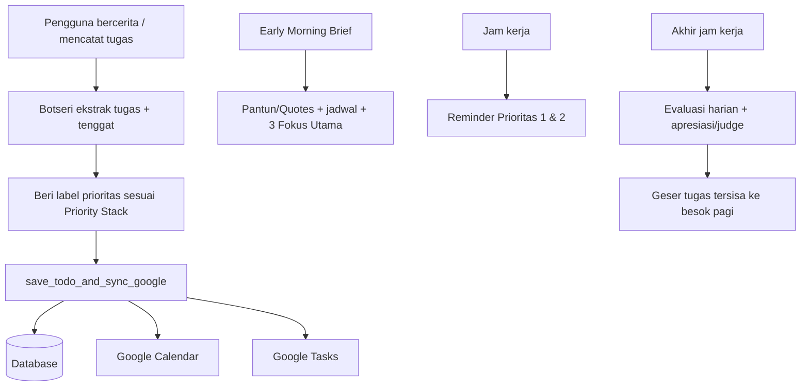
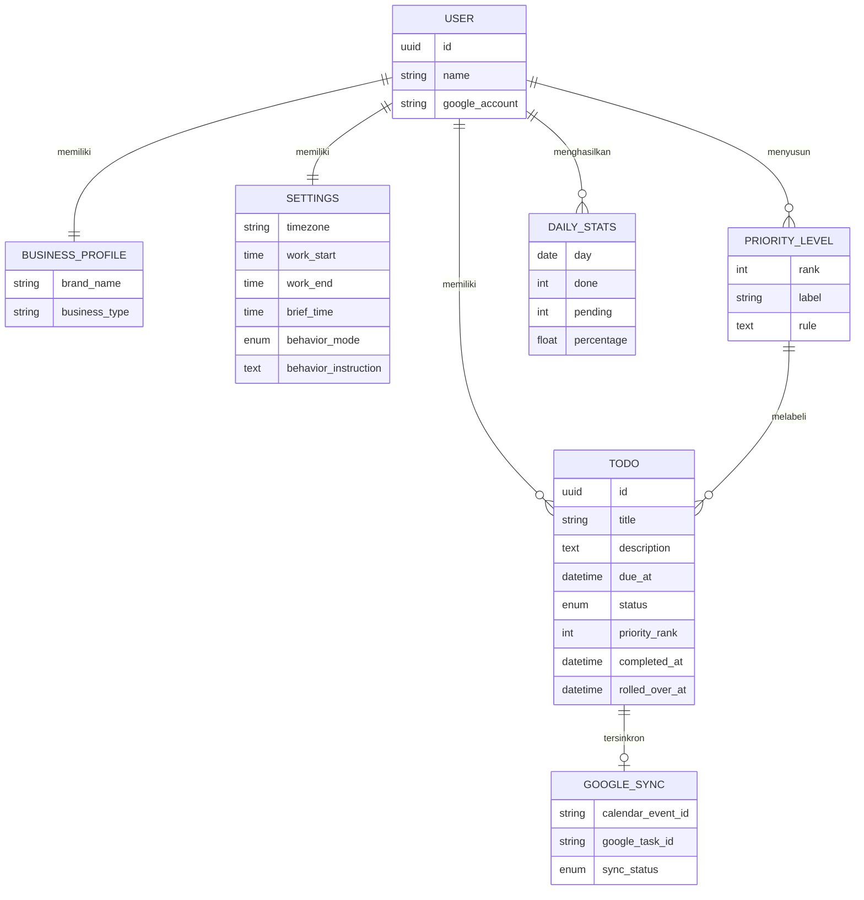

# Business Requirements Document (BRD)

## Botseri — Asisten Operasional & Produktivitas Pribadi

| Atribut | Keterangan |
|---|---|
| Nama Dokumen | BRD Botseri |
| Versi | 1.0 (Draft) |
| Tanggal | 19 Oktober 2026 |
| Penyusun | Moxikeru |
| Status | Draft untuk ditinjau |
| Zona Waktu Acuan | Asia/Jakarta (WIB, UTC+07:00), dapat dikonfigurasi per pengguna |

---

## 1. Ringkasan Eksekutif

Botseri adalah asisten operasional berbasis LLM yang membantu pemilik usaha kecil mengelola tugas harian, tenggat, dan jadwal melalui percakapan. Contoh kasus penggunaan dalam rancangan awal adalah bisnis florist (buket, dekorasi, pengiriman), tetapi produk dirancang generik melalui variabel `{{brand_name}}` dan `{{business_type}}` sehingga dapat dipakai untuk jenis usaha lain.

Botseri bekerja dalam empat mode pemicu (trigger): menerima catatan tugas lewat chat, mengirim ringkasan pagi, mengingatkan tugas prioritas saat jam kerja, dan mengevaluasi capaian di akhir hari. Seluruh pengurutan tugas mengikuti **Priority Stack** yang disusun pemilik usaha melalui dashboard drag-and-drop. Tugas disimpan di basis data dan disinkronkan ke Google Calendar dan Google Tasks.

Gaya komunikasi dapat dipilih pengguna: **STRICT** (tegas, disiplin, boleh menyindir) atau **SANTAI** (hangat, suportif).

---

## 2. Latar Belakang dan Permasalahan Bisnis

### 2.1 Latar Belakang

Pemilik usaha kecil, khususnya usaha berbasis pesanan dengan bahan mudah rusak seperti florist, mengelola banyak hal sekaligus: pesanan masuk lewat chat, belanja bahan, pengiriman, penagihan, dan administrasi. Catatan biasanya tersebar di chat, memo, dan ingatan pribadi.

### 2.2 Permasalahan

| ID | Permasalahan | Dampak |
|---|---|---|
| P-01 | Tugas dan pesanan baru dicatat tidak terstruktur (cerita bebas di chat) | Tenggat terlewat, detail pesanan hilang |
| P-02 | Tidak ada urutan prioritas yang konsisten | Tugas kritis (pengiriman H-1) kalah oleh tugas rutin |
| P-03 | Bahan mudah layu dan pengiriman berbatas waktu tidak diingatkan secara proaktif | Kerugian bahan, keterlambatan pengiriman |
| P-04 | Penagihan DP dan pelunasan sering tertunda | Arus kas terganggu |
| P-05 | Tidak ada evaluasi harian dan pembelajaran dari kebiasaan menunda | Pola penundaan berulang |
| P-06 | Pencatatan manual ke kalender dan task manager memakan waktu | Data tidak sinkron |

### 2.3 Peluang

Percakapan natural sebagai satu-satunya antarmuka input, ditambah pengingat proaktif berbasis prioritas bisnis, dapat menurunkan beban pencatatan dan meningkatkan disiplin eksekusi.

---

## 3. Tujuan Bisnis dan Indikator Keberhasilan

### 3.1 Tujuan Bisnis

| ID | Tujuan |
|---|---|
| BO-01 | Mengubah cerita atau catatan bebas menjadi item to-do terstruktur dengan tenggat dan prioritas |
| BO-02 | Memastikan tugas berprioritas tinggi selalu tampil lebih dahulu dan diingatkan |
| BO-03 | Mengurangi tugas yang terlewat tenggat |
| BO-04 | Menyinkronkan tugas ke ekosistem Google tanpa input ganda |
| BO-05 | Membangun kebiasaan kerja lewat ringkasan pagi dan evaluasi sore |
| BO-06 | Memberi pengguna kendali atas prioritas dan gaya komunikasi bot |

### 3.2 Key Performance Indicators

| KPI | Target awal (usulan, perlu divalidasi) |
|---|---|
| Akurasi ekstraksi tugas (tugas dan tenggat benar tanpa koreksi manual) | ≥ 90% |
| Persentase tugas Prioritas 1 yang selesai sebelum tenggat | ≥ 95% |
| Keberhasilan sinkronisasi ke Google Calendar dan Tasks | ≥ 99% |
| Pesan Morning Brief terkirim tepat waktu (toleransi ±2 menit) | ≥ 99% |
| Rata-rata penyelesaian tugas harian (daily completion rate) | Naik ≥ 15% dalam 60 hari pemakaian |
| Retensi pengguna aktif mingguan setelah 30 hari | ≥ 60% |

---

## 4. Ruang Lingkup

### 4.1 Dalam Lingkup (In Scope)

1. Penerimaan dan ekstraksi tugas dari chat bahasa Indonesia.
2. Penyimpanan tugas ke basis data dan sinkronisasi ke Google Calendar dan Google Tasks.
3. Pengurutan tugas menurut Priority Stack.
4. Empat mode trigger: `CHAT_MASUK`, `MORNING_BRIEF`, `WORK_HOURS_REMINDER`, `END_OF_DAY_EVAL`.
5. Dua mode perilaku: `STRICT` dan `SANTAI`.
6. Dashboard pengaturan: Priority Stack drag-and-drop, jam kerja, jam brief, mode perilaku, profil bisnis.
7. Statistik harian dan evaluasi dengan tiga tingkat respons.
8. Penggeseran otomatis tugas yang belum selesai ke hari berikutnya.

### 4.2 Di Luar Lingkup (Out of Scope) — Versi 1.0

1. Manajemen stok, inventaris, dan pembukuan.
2. Pembayaran dan pembuatan invoice (Botseri hanya mengingatkan penagihan).
3. Kolaborasi multi-pengguna atau penugasan ke karyawan.
4. Integrasi kalender selain Google.
5. Input suara dan gambar.
6. Aplikasi mobile native (kanal awal mengikuti kanal chat yang dipilih, lihat bagian 14).

---

## 5. Pemangku Kepentingan dan Persona

| Pemangku Kepentingan | Peran | Kepentingan |
|---|---|---|
| Pemilik usaha (pengguna utama) | Pengguna akhir, penyusun Priority Stack | Tugas terkelola, tidak ada tenggat terlewat |
| Pengembang / Admin sistem | Membangun dan memelihara sistem | Stabilitas, biaya LLM terkendali |
| Penyedia layanan Google | Integrasi API | Kepatuhan kebijakan OAuth dan kuota API |
| Penyedia LLM | Mesin inferensi | Latensi dan biaya per token |

**Persona utama: "Pemilik Usaha Florist"**
Mengelola usaha sendiri atau dengan tim kecil, sering bekerja di lapangan, mencatat lewat chat singkat, menyukai respons cepat dan jelas, dan membutuhkan dorongan disiplin pada hari padat pesanan.

---

## 6. Proses Bisnis

### 6.1 Kondisi Saat Ini (As-Is)

1. Pesanan diterima lewat chat, dicatat manual atau diingat.
2. Pemilik menentukan sendiri apa yang dikerjakan lebih dulu.
3. Kalender dan task manager diisi manual, sering terlambat atau tidak diisi.
4. Tidak ada evaluasi harian.

### 6.2 Kondisi Target (To-Be)

---

## 7. Kebutuhan Bisnis (Business Requirements)

| ID | Kebutuhan Bisnis | Prioritas | Tujuan Terkait |
|---|---|---|---|
| BR-01 | Sistem harus menerima catatan tugas dalam bahasa natural dan mengubahnya menjadi to-do terstruktur | Must | BO-01 |
| BR-02 | Setiap tugas harus memiliki tenggat dan label prioritas sesuai Priority Stack pengguna | Must | BO-01, BO-02 |
| BR-03 | Tugas harus tersimpan di basis data dan tersinkron ke Google Calendar dan Google Tasks | Must | BO-04 |
| BR-04 | Sistem harus menampilkan maksimal 3 fokus utama ketika pengguna bertanya apa yang harus dikerjakan | Must | BO-02 |
| BR-05 | Sistem harus memperbarui status tugas menjadi selesai saat pengguna melapor | Must | BO-01 |
| BR-06 | Sistem harus mengirim Morning Brief pada jam yang dikonfigurasi | Must | BO-05 |
| BR-07 | Sistem harus mengirim pengingat Prioritas 1 dan 2 hanya pada jam kerja | Must | BO-02, BO-03 |
| BR-08 | Sistem harus mengirim evaluasi harian tepat pada akhir jam kerja dengan respons sesuai persentase penyelesaian | Must | BO-05 |
| BR-09 | Tugas yang belum selesai harus digeser ke jadwal esok pagi | Must | BO-03 |
| BR-10 | Pengguna harus dapat mengatur Priority Stack melalui dashboard drag-and-drop | Must | BO-06 |
| BR-11 | Pengguna harus dapat memilih mode perilaku `STRICT` atau `SANTAI` | Must | BO-06 |
| BR-12 | Pengguna harus dapat mengatur jam kerja dan jam Morning Brief | Must | BO-06 |
| BR-13 | Sistem harus mendukung berbagai jenis bisnis lewat variabel profil bisnis | Should | BO-06 |
| BR-14 | Sistem harus menyediakan riwayat statistik harian | Should | BO-05 |
| BR-15 | Sistem harus dapat mendeteksi dan menandai tugas yang ambigu untuk dikonfirmasi pengguna | Should | BO-01 |

---

## 8. Kebutuhan Fungsional

### 8.1 Mode `CHAT_MASUK`

| ID | Kebutuhan |
|---|---|
| FR-01 | Ketika pesan berisi cerita, catatan tugas, atau orderan baru, sistem mengekstrak satu atau lebih item to-do spesifik (judul, deskripsi, tenggat, kategori, prioritas). |
| FR-02 | Sistem menetapkan label prioritas dengan mencocokkan item terhadap `{{compiled_priority_stack}}`. |
| FR-03 | Sistem memanggil tool `save_todo_and_sync_google` untuk setiap item hasil ekstraksi. |
| FR-04 | Jika tenggat tidak disebut atau ambigu, sistem menanyakan konfirmasi singkat atau memakai tenggat default yang terdokumentasi (lihat bagian 12). |
| FR-05 | Ketika pengguna bertanya apa yang harus dikerjakan, sistem membaca `{{active_todos}}`, mengurutkan menurut Priority Stack, dan menampilkan **maksimal 3 fokus utama** di bagian atas, diikuti sisa tugas. |
| FR-06 | Ketika pengguna melapor tugas selesai, sistem memanggil `update_todo_status` dengan status `DONE`, lalu merespons sesuai `{{behavior_mode}}`. |
| FR-07 | Setelah penyimpanan, sistem mengonfirmasi ringkasan item yang tersimpan (judul, tenggat, prioritas). |

### 8.2 Mode `MORNING_BRIEF`

| ID | Kebutuhan |
|---|---|
| FR-08 | Dijalankan otomatis pada `{{early_brief_time}}` setiap hari. |
| FR-09 | Pesan menyapa pengguna dengan semangat pagi. |
| FR-10 | Pesan **wajib** dibuka dengan pantun empat baris atau kutipan hari ini yang relevan dengan dunia kerja, bisnis, atau jenis usaha pengguna. |
| FR-11 | Pesan merangkum jadwal acara hari ini (dari Google Calendar dan data tugas). |
| FR-12 | Pesan memuat bagian "🔥 3 Fokus Utama Pagi Ini" dan "📋 Tugas Selanjutnya", diurutkan menurut Priority Stack. |

### 8.3 Mode `WORK_HOURS_REMINDER`

| ID | Kebutuhan |
|---|---|
| FR-13 | Hanya berjalan di antara `{{work_hours_start}}` dan `{{work_hours_end}}`. |
| FR-14 | Memeriksa tugas Prioritas 1 dan 2 yang belum selesai. |
| FR-15 | Mengingatkan pengguna untuk mencicil atau menyelesaikan tugas tersebut dengan gaya bahasa sesuai `{{behavior_mode}}`. |
| FR-16 | Tidak mengirim pengingat jika tidak ada tugas Prioritas 1 dan 2 yang tertunda. |

### 8.4 Mode `END_OF_DAY_EVAL`

| ID | Kebutuhan |
|---|---|
| FR-17 | Dijalankan tepat pada `{{work_hours_end}}`. |
| FR-18 | Menghitung statistik dari `{{daily_stats}}`: jumlah selesai (X), belum selesai (Y), persentase (Z%). |
| FR-19 | Penyelesaian ≥ 70%: apresiasi tinggi dan saran beristirahat. |
| FR-20 | Penyelesaian 40%–69%: apresiasi secukupnya disertai dorongan atau evaluasi ringan untuk tugas menggantung. |
| FR-21 | Penyelesaian < 40%, mode `STRICT`: sindiran tajam atau roasting lucu mengenai tugas terbengkalai. |
| FR-22 | Penyelesaian < 40%, mode `SANTAI`: teguran lembut dan pertanyaan apakah pengguna kelelahan atau kewalahan. |
| FR-23 | Pesan ditutup dengan informasi bahwa tugas yang belum selesai telah digeser ke jadwal esok pagi. |
| FR-24 | Sistem benar-benar menggeser tenggat atau jadwal tugas tersisa (di basis data, Calendar, dan Tasks) sebelum pesan dikirim. |

### 8.5 Dashboard Pengaturan

| ID | Kebutuhan |
|---|---|
| FR-25 | Pengguna dapat menyusun ulang daftar prioritas dengan drag-and-drop; hasil dikompilasi menjadi `{{compiled_priority_stack}}`. |
| FR-26 | Setiap tingkat prioritas memiliki nama, deskripsi aturan, dan tingkat urgensi (mis. "Prioritas 1 - Kritis, deadline < 24 jam"). |
| FR-27 | Pengguna dapat menambah, mengubah, dan menghapus tingkat prioritas. |
| FR-28 | Pengguna dapat memilih `STRICT` atau `SANTAI`; teks instruksi perilaku (`{{behavior_instruction}}`) dapat disesuaikan. |
| FR-29 | Pengguna dapat mengatur jam kerja, jam Morning Brief, zona waktu, nama brand, dan jenis bisnis. |
| FR-30 | Pengguna dapat menghubungkan atau memutus akun Google dan melihat status sinkronisasi. |
| FR-31 | Pengguna dapat melihat, mengubah, dan menghapus tugas, serta melihat riwayat statistik harian. |

---

## 9. Aturan Bisnis

| ID | Aturan |
|---|---|
| BRL-01 | Urutan tugas selalu mengikuti Priority Stack dari tertinggi ke terendah; di dalam tingkat yang sama, tenggat terdekat didahulukan. |
| BRL-02 | Tampilan "fokus utama" dibatasi maksimal 3 item. |
| BRL-03 | Pengingat proaktif tidak boleh dikirim di luar jam kerja, kecuali Morning Brief. |
| BRL-04 | Ambang evaluasi: ≥ 70% (apresiasi tinggi), 40%–69% (apresiasi + dorongan), < 40% (judge). |
| BRL-05 | Gaya roasting pada mode `STRICT` berfokus pada perilaku menunda, bukan merendahkan pribadi; tidak memuat hinaan terkait fisik, identitas, atau hal sensitif. |
| BRL-06 | Perubahan status tugas hanya dilakukan atas laporan pengguna atau aksi di dashboard. |
| BRL-07 | Tugas yang belum selesai pada akhir hari digeser ke esok pagi dan tidak dihapus. |
| BRL-08 | Data pengguna tidak dipakai di luar fungsi Botseri tanpa persetujuan. |

### 9.1 Contoh Priority Stack Awal (Bisnis Florist)

| Tingkat | Label | Aturan |
|---|---|---|
| 1 | Kritis | Eksekusi dekorasi dan pengiriman buket Hari-H atau besok (deadline < 24 jam) |
| 2 | Penting dan mudah rusak | Belanja bunga segar dan conditioning bahan mudah layu |
| 3 | Cashflow | Penagihan DP dan pelunasan invoice klien |
| 4 | Rutin | Operasional gudang, rekap admin, balas chat inquiry baru |

---

## 10. Kamus Variabel Template

| Variabel | Sumber | Deskripsi |
|---|---|---|
| `{{brand_name}}` | Profil bisnis | Nama brand pengguna |
| `{{business_type}}` | Profil bisnis | Jenis usaha (mis. florist) |
| `{{current_datetime}}` | Sistem | Tanggal dan waktu saat ini |
| `{{timezone}}` | Pengaturan | Zona waktu pengguna |
| `{{work_hours_start}}` / `{{work_hours_end}}` | Pengaturan | Batas jam kerja |
| `{{early_brief_time}}` | Pengaturan | Jam Morning Brief |
| `{{trigger_type}}` | Scheduler / Chat handler | `CHAT_MASUK`, `MORNING_BRIEF`, `WORK_HOURS_REMINDER`, `END_OF_DAY_EVAL` |
| `{{behavior_mode}}` | Pengaturan | `STRICT` atau `SANTAI` |
| `{{behavior_instruction}}` | Pengaturan | Instruksi gaya bahasa sesuai mode |
| `{{compiled_priority_stack}}` | Dashboard drag-and-drop | Daftar prioritas terurut dalam teks |
| `{{active_todos}}` | Basis data | Tugas berstatus aktif |
| `{{daily_stats}}` | Basis data | Jumlah selesai, belum selesai, persentase hari ini |

---

## 11. Spesifikasi Tool dan Integrasi

### 11.1 `save_todo_and_sync_google`

| Elemen | Keterangan |
|---|---|
| Tujuan | Menyimpan tugas ke DB, membuat event di Google Calendar, dan task di Google Tasks |
| Input | `title`, `description`, `due_datetime`, `priority_level`, `category`, `source_message_id` |
| Output | `todo_id`, `calendar_event_id`, `google_task_id`, `sync_status` |
| Kegagalan | Jika sinkronisasi Google gagal, tugas tetap tersimpan di DB dengan `sync_status = PENDING`, dicoba ulang otomatis, dan pengguna diberi tahu |

### 11.2 `update_todo_status`

| Elemen | Keterangan |
|---|---|
| Tujuan | Mengubah status tugas menjadi `DONE` (dan status lain yang didukung) |
| Input | `todo_id`, `status` |
| Efek samping | Menandai selesai di Google Tasks dan memperbarui statistik harian |
| Kegagalan | Jika `todo_id` tidak jelas, bot menanyakan tugas mana yang dimaksud |

### 11.3 Integrasi Eksternal

| Integrasi | Kegunaan |
|---|---|
| Google Calendar API | Membuat dan memperbarui event tugas, membaca jadwal Morning Brief |
| Google Tasks API | Membuat dan menyelesaikan task |
| Google OAuth 2.0 | Otorisasi akun pengguna dengan cakupan akses minimum |
| Scheduler | Memicu `MORNING_BRIEF`, `WORK_HOURS_REMINDER`, `END_OF_DAY_EVAL` |
| LLM | Ekstraksi tugas dan pembuatan respons bergaya |
| Kanal chat | Antarmuka percakapan (lihat bagian 14, pertanyaan terbuka) |

---

## 12. Model Data Tingkat Tinggi

**Status tugas yang diusulkan:** `ACTIVE`, `DONE`, `CANCELLED`.

**Tenggat default (usulan):** jika pengguna tidak menyebut waktu, gunakan akhir jam kerja pada tanggal yang disebut; jika tanggal tidak disebut, tanyakan konfirmasi.

---

## 13. Kebutuhan Non-Fungsional

| ID | Kategori | Kebutuhan |
|---|---|---|
| NFR-01 | Performa | Respons chat biasa ≤ 5 detik pada persentil ke-90, di luar latensi sinkronisasi Google |
| NFR-02 | Ketepatan jadwal | Pemicu terjadwal berjalan dengan deviasi ≤ 2 menit |
| NFR-03 | Ketersediaan | ≥ 99% pada jam kerja pengguna |
| NFR-04 | Keamanan | Token Google OAuth terenkripsi saat disimpan; cakupan akses minimum; seluruh lalu lintas HTTPS |
| NFR-05 | Privasi | Data tugas hanya dapat diakses pemiliknya; penghapusan akun menghapus data dan mencabut token |
| NFR-06 | Keandalan | Antrean ulang (retry dengan backoff) untuk sinkronisasi Google yang gagal; tidak ada duplikasi event |
| NFR-07 | Bahasa | Bahasa utama Indonesia; mampu memahami bahasa informal dan singkatan umum |
| NFR-08 | Skalabilitas | Mendukung penambahan pengguna tanpa perubahan arsitektur; penjadwalan per zona waktu |
| NFR-09 | Observabilitas | Log pemanggilan tool, kegagalan sinkronisasi, dan biaya token per pengguna |
| NFR-10 | Biaya | Pemantauan biaya LLM per pengguna per hari; batas penggunaan wajar dapat dikonfigurasi |
| NFR-11 | Konsistensi konten | Respons tidak mengarang tugas, tenggat, atau angka statistik yang tidak ada di data |
| NFR-12 | Usabilitas | Dashboard dapat dipakai di layar ponsel dan desktop |

---

## 14. Asumsi, Batasan, dan Ketergantungan

### 14.1 Asumsi

1. Pengguna memiliki akun Google dan bersedia memberi akses Calendar dan Tasks.
2. Pengguna menulis catatan tugas dalam bahasa Indonesia.
3. Satu bot melayani satu pemilik usaha (single-user per akun) pada versi 1.0.
4. Jam kerja berlaku sama setiap hari kerja; hari libur diatur manual (lihat gap G-05).

### 14.2 Batasan

1. Kuota dan kebijakan Google API membatasi frekuensi sinkronisasi.
2. Kualitas ekstraksi bergantung pada kejelasan input pengguna.
3. Pengingat proaktif bergantung pada kemampuan kanal chat untuk mengirim pesan terlebih dahulu.

### 14.3 Ketergantungan

Layanan LLM, Google API, penyedia basis data, scheduler/cron, dan kanal chat yang dipilih.

---

## 15. Risiko dan Mitigasi

| ID | Risiko | Dampak | Kemungkinan | Mitigasi |
|---|---|---|---|---|
| R-01 | Salah ekstraksi tenggat atau tugas | Tinggi | Sedang | Konfirmasi ringkas setelah simpan; tombol koreksi; konfirmasi untuk input ambigu |
| R-02 | Kegagalan sinkronisasi Google | Sedang | Sedang | Retry otomatis, status `PENDING`, notifikasi pengguna |
| R-03 | Pengingat berlebihan membuat pengguna jengkel | Sedang | Sedang | Batas frekuensi, pengingat hanya Prioritas 1 dan 2, pengaturan interval |
| R-04 | Roasting mode `STRICT` terasa menyakitkan | Sedang | Rendah | Pengguna memilih sendiri, batas nada (BRL-05), pengguna dapat berpindah ke `SANTAI` kapan saja |
| R-05 | Biaya LLM membengkak | Sedang | Sedang | Batas pemakaian, templat ringkas, model berbeda per trigger |
| R-06 | Kebocoran token atau data pengguna | Tinggi | Rendah | Enkripsi, cakupan minimum, audit akses |
| R-07 | Halusinasi data (statistik atau tugas tidak ada) | Tinggi | Sedang | Statistik dihitung oleh kode, bukan LLM; LLM hanya menyusun narasi |
| R-08 | Prioritas ganda atau konflik antar tingkat | Rendah | Sedang | Aturan tie-break (BRL-01) dan konfirmasi saat item cocok ke lebih dari satu tingkat |

---

## 16. Kriteria Penerimaan (UAT)

| ID | Skenario | Kriteria Diterima |
|---|---|---|
| UAT-01 | Pengguna mengirim cerita berisi dua orderan dengan tenggat berbeda | Dua item tersimpan, masing-masing dengan tenggat dan prioritas benar, muncul di DB, Calendar, dan Tasks |
| UAT-02 | Pengguna bertanya "hari ini ngerjain apa?" saat ada 7 tugas aktif | Maksimal 3 fokus utama di atas, urut sesuai Priority Stack, sisa tugas di bawahnya |
| UAT-03 | Pengguna menulis "buket Bu Ani sudah terkirim" | Tugas terkait berstatus `DONE` di DB dan Google Tasks; respons sesuai mode |
| UAT-04 | Morning Brief pada jam yang diatur | Terkirim tepat waktu, dibuka pantun 4 baris atau kutipan, memuat jadwal, "3 Fokus Utama", dan "Tugas Selanjutnya" |
| UAT-05 | Pukul di dalam jam kerja, ada tugas Prioritas 1 tertunda | Pengingat terkirim dengan gaya sesuai mode |
| UAT-06 | Pukul di luar jam kerja | Tidak ada pengingat proaktif (kecuali Morning Brief) |
| UAT-07 | Akhir hari, penyelesaian 80% | Apresiasi tinggi, saran istirahat, angka X/Y/Z% sesuai data |
| UAT-08 | Akhir hari, penyelesaian 55% | Apresiasi secukupnya dan dorongan ringan |
| UAT-09 | Akhir hari, penyelesaian 30%, mode `STRICT` | Roasting lucu tanpa hinaan personal |
| UAT-10 | Akhir hari, penyelesaian 30%, mode `SANTAI` | Teguran lembut dan pertanyaan soal kelelahan |
| UAT-11 | Akhir hari dengan tugas tersisa | Tugas tergeser ke esok pagi di DB, Calendar, dan Tasks; pesan memberi tahu hal ini |
| UAT-12 | Pengguna mengubah urutan Priority Stack di dashboard | Pengurutan berikutnya langsung mengikuti urutan baru |
| UAT-13 | Google API gagal saat menyimpan | Tugas tersimpan dengan `PENDING`, pengguna diberi tahu, sinkronisasi berhasil pada percobaan ulang |

---

## 17. Gap dan Pertanyaan Terbuka dari Rancangan Awal

Poin berikut belum terdefinisi pada rancangan prompt dan perlu keputusan sebelum implementasi.

| ID | Gap | Usulan |
|---|---|---|
| G-01 | Kanal chat belum ditentukan (WhatsApp, Telegram, web chat) | Tentukan kanal; Telegram paling mudah untuk pesan proaktif |
| G-02 | Frekuensi `WORK_HOURS_REMINDER` tidak disebut | Default setiap 2–3 jam, dapat diatur pengguna |
| G-03 | Definisi "persentase penyelesaian" belum jelas (tugas yang jatuh tempo hari ini saja, atau semua tugas aktif?) | Hitung dari tugas dengan tenggat hari ini ditambah tugas geseran |
| G-04 | Tugas yang terus digeser berhari-hari | Tandai "menggantung" setelah N kali digeser dan minta pengguna memutuskan |
| G-05 | Hari libur dan akhir pekan | Tambah pengaturan hari kerja dan hari libur |
| G-06 | Perilaku jika tidak ada tugas pada Morning Brief | Kirim pantun/quotes dan ajak pengguna menambah tugas |
| G-07 | Evaluasi saat tidak ada tugas hari itu (pembagi nol) | Lewati statistik, kirim pesan netral |
| G-08 | Pembatalan atau penundaan tugas oleh pengguna | Tambah tool `update_todo` dan status `CANCELLED` |
| G-09 | Pengeditan tugas yang sudah tersinkron | Perluas tool agar memperbarui event dan task Google |
| G-10 | Penanganan pesan yang tidak terkait tugas (obrolan bebas) | Balas singkat sesuai persona dan arahkan ke fungsi utama |
| G-11 | Hierarki saat satu tugas cocok dengan beberapa tingkat prioritas | Pilih tingkat tertinggi, atau minta konfirmasi bila ragu |
| G-12 | Kebijakan retensi data dan persetujuan pengguna | Tentukan masa simpan dan halaman persetujuan |

---

## 18. Rencana Rilis

| Fase | Cakupan | Hasil |
|---|---|---|
| Fase 1 — MVP | `CHAT_MASUK`, tool simpan dan update status, Priority Stack statis, sinkronisasi Google Tasks | Pengguna dapat mencatat dan menyelesaikan tugas lewat chat |
| Fase 2 | Morning Brief, Work Hours Reminder, sinkronisasi Calendar, pengaturan jam kerja | Pengingat proaktif berjalan |
| Fase 3 | End of Day Eval, statistik harian, penggeseran otomatis, mode `STRICT` dan `SANTAI` | Siklus harian lengkap |
| Fase 4 | Dashboard drag-and-drop Priority Stack, riwayat statistik, pengaturan profil bisnis | Kustomisasi penuh oleh pengguna |
| Fase 5 | Penyempurnaan: tugas berulang, hari libur, multi-bisnis | Peningkatan berdasarkan umpan balik |

---

## 19. Glosarium

| Istilah | Arti |
|---|---|
| Priority Stack | Daftar tingkat prioritas terurut yang disusun pengguna dan menentukan urutan pengerjaan tugas |
| Trigger | Kejadian yang mengaktifkan Botseri: chat masuk atau jadwal otomatis |
| Morning Brief | Ringkasan pagi berisi pantun/quotes, jadwal, dan fokus utama |
| Judge | Respons evaluatif berupa sindiran (`STRICT`) atau teguran lembut (`SANTAI`) saat penyelesaian rendah |
| Conditioning | Perawatan bunga segar agar tahan lama setelah dibeli |
| DP | Down payment, uang muka pesanan |
| Sync | Penyelarasan data tugas ke Google Calendar dan Google Tasks |

---

## 20. Persetujuan

| Nama | Peran | Tanda Tangan | Tanggal |
|---|---|---|---|
| Moxikeru | Product Owner / Penyusun | | |
| | Pengembang | | |
| | Pengguna Uji | | |
