# DATABASE.md — Spesifikasi Basis Data Botseri

> **Status:** Kanonik · **Arsitektur Rujukan:** `ARCHITECTURE.md` §5, §10, §11 · **Database Engine:** PostgreSQL 16
> **ORM:** Prisma ORM (v5+) · **Invarian SSOT:** INV-01 (PostgreSQL adalah satu-satunya sumber kebenaran, hanya `botseri-dashboard` yang terhubung)

---

## 1. Diagram Relasi Entitas (ERD)

```mermaid
erDiagram
    admin_users {
        uuid id PK
        string username UK
        string password_hash
        timestamptz created_at
        timestamptz updated_at
    }

    bot_settings {
        int id PK "selalu 1"
        string brand_name
        string business_type
        string owner_name
        string timezone
        string work_hours_start
        string work_hours_end
        string early_brief_time
        int_array working_days
        enum behavior_mode
        text behavior_instruction
        enum prompt_mode
        text custom_prompt_template
        text compiled_prompt
        int compiled_prompt_version
        timestamptz compiled_at
        int reminder_interval_minutes
        int reminder_max_per_day
        int reminder_max_rank
        int brief_window_minutes
        int eod_window_minutes
        string default_due_time
        enum google_sync_mode
        boolean bot_enabled
        boolean setup_completed
        timestamptz created_at
        timestamptz updated_at
    }

    priority_levels {
        uuid id PK
        int rank UK "1 = tertinggi"
        string label
        text description
        text rule_text
        string color
        timestamptz created_at
        timestamptz updated_at
    }

    orders {
        uuid id PK
        string customer_name
        string customer_contact
        text description
        timestamptz event_date
        timestamptz delivery_date
        text delivery_address
        numeric total_amount "14,2"
        numeric dp_amount "14,2"
        enum payment_status
        text notes
        timestamptz created_at
        timestamptz updated_at
    }

    todos {
        uuid id PK
        varchar title "120"
        text description
        varchar category "40"
        enum status
        uuid priority_level_id FK "SET NULL"
        int priority_rank
        timestamptz due_at
        boolean has_specific_time
        date planned_date
        uuid order_id FK "SET NULL"
        int rollover_count
        timestamptz completed_at
        string source_message_id
        string dedupe_key UK
        enum created_via
        string calendar_event_id
        string google_task_id
        enum google_sync_status
        int google_sync_attempts
        text google_sync_error
        timestamptz created_at
        timestamptz updated_at
    }

    authorized_numbers {
        uuid id PK
        string chat_id UK
        string phone_e164
        string label
        boolean is_owner
        timestamptz created_at
    }

    pairing_codes {
        uuid id PK
        string code_hash UK
        timestamptz expires_at
        timestamptz used_at
        timestamptz created_at
    }

    message_log {
        uuid id PK
        enum direction
        string wa_message_id UK
        string chat_id
        text body
        string media_type
        text transcript
        string in_reply_to
        timestamptz created_at
    }

    llm_configs {
        uuid id PK
        string provider
        string model
        string base_url
        text api_key_enc
        string stt_model
        float temperature
        int max_output_tokens
        numeric price_input_per_mtok "10,4"
        numeric price_output_per_mtok "10,4"
        boolean is_active
        timestamptz created_at
        timestamptz updated_at
    }

    oauth_tokens {
        uuid id PK
        string provider
        string account_email
        string_array scopes
        string client_id
        text client_secret_enc
        text access_token_enc
        text refresh_token_enc
        timestamptz expires_at
        enum status
        string calendar_id
        string tasklist_id
        timestamptz created_at
        timestamptz updated_at
    }

    llm_usage_logs {
        uuid id PK
        timestamptz ts
        string call_type
        string provider
        string model
        int prompt_tokens
        int completion_tokens
        numeric cost_usd "10,6"
        int latency_ms
        string n8n_execution_id
        boolean success
        text error
    }

    daily_execution_logs {
        uuid id PK
        date local_date
        enum job_type
        int seq
        enum status
        int attempts
        timestamptz claimed_at
        timestamptz sent_at
        text error
    }

    daily_stats {
        date local_date PK
        int target_count
        int done_count
        int pending_count
        numeric completion_rate "5,2"
        enum tier
        int rolled_over_count
        timestamptz snapshot_at
    }

    holidays {
        date date PK
        string label
        timestamptz created_at
    }

    system_events {
        uuid id PK
        timestamptz ts
        string level
        string source
        string code
        text message
        jsonb context
    }

    priority_levels ||--o{ todos : "melabeli"
    orders ||--o{ todos : "memiliki item pekerjaan"
```



---

## 2. Kamus Enumerasi

| Enum | Nilai | Penjelasan |
|---|---|---|
| `BehaviorMode` | `STRICT`, `SANTAI` | Mode interaksi bot dan gaya evaluasi harian |
| `PromptMode` | `STACK`, `CUSTOM` | Mode kompilasi prompt sistem (otomatis vs kustom) |
| `TodoStatus` | `PENDING`, `IN_PROGRESS`, `DONE`, `CANCELLED` | Status lifecycle to-do |
| `GoogleSyncStatus` | `NOT_REQUIRED`, `PENDING`, `SYNCED`, `FAILED` | Status sinkronisasi ke Google Tasks/Calendar |
| `GoogleSyncMode` | `AUTO`, `BOTH` | `AUTO`: Waktu spesifik → Calendar, selain itu → Tasks. `BOTH`: Keduanya |
| `JobType` | `MORNING_BRIEF`, `WORK_HOURS_REMINDER`, `END_OF_DAY_EVAL` | Jenis pekerjaan proaktif terjadwal |
| `JobStatus` | `CLAIMED`, `SENT`, `FAILED`, `SKIPPED` | Status eksekusi pekerjaan di `daily_execution_logs` |
| `EvalTier` | `HIGH`, `MID`, `LOW`, `NO_TASKS` | Kategori capaian harian: `HIGH` (≥70%), `MID` (40–<70%), `LOW` (<40%), `NO_TASKS` (target=0) |
| `MessageDirection` | `INBOUND`, `OUTBOUND` | Arah lalu lintas pesan WhatsApp |
| `OAuthStatus` | `CONNECTED`, `NEEDS_REAUTH`, `DISCONNECTED` | Status token OAuth Google |
| `OrderPaymentStatus` | `UNPAID`, `DP_PAID`, `PAID` | Status penagihan pesanan |
| `TodoCreatedVia` | `CHAT`, `DASHBOARD`, `SYSTEM` | Sumber pembuatan to-do |
| `CustomerSessionState` | `INIT`, `AWAITING_CHOICE`, `AWAITING_ORDER`, `PAUSED_FOR_OWNER`, `ACTIVE` | Status state machine sesi percakapan inbound pelanggan |

---

## 3. Spesifikasi Detail Tabel

### 3.1 `admin_users`
Menyimpan akun tunggal admin pengelola dashboard Botseri.
- `id` (`UUID`, PK, default `gen_random_uuid()`)
- `username` (`VARCHAR(255)`, UNIQUE, NOT NULL)
- `password_hash` (`TEXT`, NOT NULL): di-hash menggunakan Argon2id
- `created_at` (`TIMESTAMPTZ`, default `now()`)
- `updated_at` (`TIMESTAMPTZ`, default `now()`)

### 3.2 `bot_settings`
Pengaturan bot dan profil bisnis (baris tunggal / singleton `id = 1`).
- `id` (`INTEGER`, PK, default 1, CHECK `id = 1`)
- `brand_name` (`VARCHAR(100)`, default `""`)
- `business_type` (`VARCHAR(100)`, default `""`)
- `owner_name` (`VARCHAR(100)`, default `""`)
- `timezone` (`VARCHAR(50)`, default `"Asia/Jakarta"`)
- `work_hours_start` (`VARCHAR(5)`, default `"08:00"`): format HH:mm
- `work_hours_end` (`VARCHAR(5)`, default `"17:00"`): format HH:mm
- `early_brief_time` (`VARCHAR(5)`, default `"06:00"`): format HH:mm
- `working_days` (`SMALLINT[]`, default `ARRAY[1,2,3,4,5,6]`): 1=Senin s/d 7=Minggu
- `behavior_mode` (`BehaviorMode`, default `STRICT`)
- `behavior_instruction` (`TEXT`, NULL)
- `prompt_mode` (`PromptMode`, default `STACK`)
- `custom_prompt_template` (`TEXT`, NULL)
- `compiled_prompt` (`TEXT`, NULL): hasil `compileSystemPrompt()`
- `compiled_prompt_version` (`INTEGER`, default 1)
- `compiled_at` (`TIMESTAMPTZ`, NULL)
- `reminder_interval_minutes` (`INTEGER`, default 120)
- `reminder_max_per_day` (`INTEGER`, default 5)
- `reminder_max_rank` (`INTEGER`, default 2): hanya tugas rank ≤ batas ini yang diingatkan
- `brief_window_minutes` (`INTEGER`, default 120)
- `eod_window_minutes` (`INTEGER`, default 120)
- `default_due_time` (`VARCHAR(5)`, default `"17:00"`)
- `google_sync_mode` (`GoogleSyncMode`, default `AUTO`)
- `bot_enabled` (`BOOLEAN`, default true)
- `setup_completed` (`BOOLEAN`, default false)
- `created_at` (`TIMESTAMPTZ`, default `now()`)
- `updated_at` (`TIMESTAMPTZ`, default `now()`)

### 3.3 `priority_levels`
Definisi Priority Stack dinamis yang disusun owner.
- `id` (`UUID`, PK, default `gen_random_uuid()`)
- `rank` (`INTEGER`, UNIQUE, NOT NULL): 1 = tingkat prioritas tertinggi
- `label` (`VARCHAR(50)`, NOT NULL): misal "Kritis / Sameday"
- `description` (`TEXT`, NULL)
- `rule_text` (`TEXT`, NOT NULL): aturan penugasan yang dibaca compiler prompt
- `color` (`VARCHAR(20)`, NULL): kode heksadesimal warna UI
- `created_at` (`TIMESTAMPTZ`, default `now()`)
- `updated_at` (`TIMESTAMPTZ`, default `now()`)

### 3.4 `orders`
Konteks pesanan pelanggan (bukan modul invoice).
- `id` (`UUID`, PK, default `gen_random_uuid()`)
- `customer_name` (`VARCHAR(150)`, NOT NULL)
- `customer_contact` (`VARCHAR(50)`, NULL)
- `description` (`TEXT`, NOT NULL)
- `event_date` (`TIMESTAMPTZ`, NULL)
- `delivery_date` (`TIMESTAMPTZ`, NULL)
- `delivery_address` (`TEXT`, NULL)
- `total_amount` (`NUMERIC(14,2)`, NULL)
- `dp_amount` (`NUMERIC(14,2)`, NULL)
- `payment_status` (`OrderPaymentStatus`, default `UNPAID`)
- `notes` (`TEXT`, NULL)
- `created_at` (`TIMESTAMPTZ`, default `now()`)
- `updated_at` (`TIMESTAMPTZ`, default `now()`)

### 3.5 `todos`
Entitas utama tugas kerja dan manajemen tenggat.
- `id` (`UUID`, PK, default `gen_random_uuid()`)
- `title` (`VARCHAR(120)`, NOT NULL)
- `description` (`TEXT`, NULL)
- `category` (`VARCHAR(40)`, NULL)
- `status` (`TodoStatus`, default `PENDING`)
- `priority_level_id` (`UUID`, FK ke `priority_levels.id`, `ON DELETE SET NULL`)
- `priority_rank` (`INTEGER`, NOT NULL): salinan rank saat to-do dibuat
- `due_at` (`TIMESTAMPTZ`, NULL)
- `has_specific_time` (`BOOLEAN`, default false): true hanya jika jam eksplisit disebut
- `planned_date` (`DATE`, NOT NULL): tanggal rencana pengerjaan
- `order_id` (`UUID`, FK ke `orders.id`, `ON DELETE SET NULL`)
- `rollover_count` (`INTEGER`, default 0)
- `completed_at` (`TIMESTAMPTZ`, NULL)
- `source_message_id` (`VARCHAR(255)`, NULL)
- `dedupe_key` (`VARCHAR(64)`, UNIQUE, NULL): `sha1(source_message_id | lower(trim(title)) | due_at)`
- `created_via` (`TodoCreatedVia`, default `CHAT`)
- `calendar_event_id` (`VARCHAR(255)`, NULL)
- `google_task_id` (`VARCHAR(255)`, NULL)
- `google_sync_status` (`GoogleSyncStatus`, default `NOT_REQUIRED`)
- `google_sync_attempts` (`INTEGER`, default 0)
- `google_sync_error` (`TEXT`, NULL)
- `created_at` (`TIMESTAMPTZ`, default `now()`)
- `updated_at` (`TIMESTAMPTZ`, default `now()`)
- **Indeks:** `(planned_date, status)`, `(priority_rank)`

### 3.6 `authorized_numbers`
Whitelist pengirim pesan WhatsApp yang diterima bot.
- `id` (`UUID`, PK, default `gen_random_uuid()`)
- `chat_id` (`VARCHAR(100)`, UNIQUE, NOT NULL): misal `6281234567890@c.us`
- `phone_e164` (`VARCHAR(20)`, NULL)
- `label` (`VARCHAR(100)`, NULL)
- `is_owner` (`BOOLEAN`, default false)
- `created_at` (`TIMESTAMPTZ`, default `now()`)


### 3.6b `customer_sessions`
Penyimpanan sesi inbound pelanggan, penjejak state machine, jeda otomatis ke owner, dan draft pesanan.
- `id` (`UUID`, PK, default `gen_random_uuid()`)
- `phone_e164` (`VARCHAR(50)`, UNIQUE, NOT NULL): nomor telepon format E.164 (misal `+6281234567890`)
- `customer_name` (`VARCHAR(255)`, NULL)
- `state` (`CustomerSessionState`, NOT NULL, default `INIT`)
- `paused_at` (`TIMESTAMPTZ`, NULL): timestamp saat bot dijeda untuk owner manual chat
- `last_message_at` (`TIMESTAMPTZ`, NOT NULL, default `now()`)
- `metadata` (`JSONB`, NULL): menampung `retry_count`, `last_message_id`, dan `draft`
- `created_at` (`TIMESTAMPTZ`, default `now()`)
- `updated_at` (`TIMESTAMPTZ`, NOT NULL, default `now()`)
### 3.7 `pairing_codes`
Penyimpanan kode pairing sementara (`PAIR-XXXXXX`) saat onboarding nomor baru.
- `id` (`UUID`, PK, default `gen_random_uuid()`)
- `code_hash` (`VARCHAR(64)`, UNIQUE, NOT NULL): SHA-256 dari kode pairing
- `expires_at` (`TIMESTAMPTZ`, NOT NULL): masa berlaku 10 menit
- `used_at` (`TIMESTAMPTZ`, NULL)
- `created_at` (`TIMESTAMPTZ`, default `now()`)

### 3.8 `message_log`
Riwayat komunikasi WhatsApp untuk dedup, context history, dan audit.
- `id` (`UUID`, PK, default `gen_random_uuid()`)
- `direction` (`MessageDirection`, NOT NULL)
- `wa_message_id` (`VARCHAR(255)`, UNIQUE, NULL)
- `chat_id` (`VARCHAR(100)`, NOT NULL)
- `body` (`TEXT`, NULL)
- `media_type` (`VARCHAR(50)`, NULL)
- `transcript` (`TEXT`, NULL): hasil transkripsi audio voice note
- `in_reply_to` (`VARCHAR(255)`, NULL)
- `created_at` (`TIMESTAMPTZ`, default `now()`)
- **Indeks:** `(chat_id, created_at)`

### 3.9 `llm_configs`
Konfigurasi provider model bahasa aktif.
- `id` (`UUID`, PK, default `gen_random_uuid()`)
- `provider` (`VARCHAR(50)`, NOT NULL): misal `openai`, `gemini`, `openrouter`
- `model` (`VARCHAR(100)`, NOT NULL)
- `base_url` (`VARCHAR(255)`, NULL)
- `api_key_enc` (`TEXT`, NOT NULL): terenkripsi AES-256-GCM
- `stt_model` (`VARCHAR(100)`, NULL)
- `temperature` (`DOUBLE PRECISION`, default 0.3)
- `max_output_tokens` (`INTEGER`, default 1000)
- `price_input_per_mtok` (`NUMERIC(10,4)`, NULL)
- `price_output_per_mtok` (`NUMERIC(10,4)`, NULL)
- `is_active` (`BOOLEAN`, default true)
- `created_at` (`TIMESTAMPTZ`, default `now()`)
- `updated_at` (`TIMESTAMPTZ`, default `now()`)

### 3.10 `oauth_tokens`
Penyimpanan kredensial OAuth2 Google API terenkripsi.
- `id` (`UUID`, PK, default `gen_random_uuid()`)
- `provider` (`VARCHAR(50)`, default `"google"`)
- `account_email` (`VARCHAR(255)`, NULL)
- `scopes` (`TEXT[]`, NOT NULL)
- `client_id` (`VARCHAR(255)`, NULL)
- `client_secret_enc` (`TEXT`, NULL): terenkripsi AES-256-GCM
- `access_token_enc` (`TEXT`, NULL): terenkripsi AES-256-GCM
- `refresh_token_enc` (`TEXT`, NULL): terenkripsi AES-256-GCM
- `expires_at` (`TIMESTAMPTZ`, NULL)
- `status` (`OAuthStatus`, default `DISCONNECTED`)
- `calendar_id` (`VARCHAR(255)`, default `"primary"`)
- `tasklist_id` (`VARCHAR(255)`, NULL)
- `created_at` (`TIMESTAMPTZ`, default `now()`)
- `updated_at` (`TIMESTAMPTZ`, default `now()`)

### 3.11 `llm_usage_logs`
Pencatatan metrik dan estimasi biaya setiap pemanggilan LLM.
- `id` (`UUID`, PK, default `gen_random_uuid()`)
- `ts` (`TIMESTAMPTZ`, default `now()`)
- `call_type` (`VARCHAR(50)`, NOT NULL): `CHAT_AGENT`, `BRIEF`, `REMINDER`, `EOD_EVAL`, `STT`
- `provider` (`VARCHAR(50)`, NOT NULL)
- `model` (`VARCHAR(100)`, NOT NULL)
- `prompt_tokens` (`INTEGER`, default 0)
- `completion_tokens` (`INTEGER`, default 0)
- `cost_usd` (`NUMERIC(10,6)`, NULL)
- `latency_ms` (`INTEGER`, NULL)
- `n8n_execution_id` (`VARCHAR(100)`, NULL)
- `success` (`BOOLEAN`, default true)
- `error` (`TEXT`, NULL)
- **Indeks:** `(ts, call_type)`

### 3.12 `daily_execution_logs`
Pencatatan job proaktif terjadwal dengan mekanisme klaim atomik.
- `id` (`UUID`, PK, default `gen_random_uuid()`)
- `local_date` (`DATE`, NOT NULL)
- `job_type` (`JobType`, NOT NULL)
- `seq` (`INTEGER`, default 0): urutan reminder ke-k dalam sehari
- `status` (`JobStatus`, default `CLAIMED`)
- `attempts` (`INTEGER`, default 1)
- `claimed_at` (`TIMESTAMPTZ`, default `now()`)
- `sent_at` (`TIMESTAMPTZ`, NULL)
- `error` (`TEXT`, NULL)
- **Constraint Unik:** `UNIQUE (local_date, job_type, seq)`

### 3.13 `daily_stats`
Snapshot evaluasi harian sebelum operasi rollover.
- `local_date` (`DATE`, PK)
- `target_count` (`INTEGER`, NOT NULL)
- `done_count` (`INTEGER`, NOT NULL)
- `pending_count` (`INTEGER`, NOT NULL)
- `completion_rate` (`NUMERIC(5,2)`, NULL): persentase (0–100)
- `tier` (`EvalTier`, NOT NULL)
- `rolled_over_count` (`INTEGER`, default 0)
- `snapshot_at` (`TIMESTAMPTZ`, default `now()`)

### 3.14 `holidays`
Daftar hari libur nasional atau cuti operasional.
- `date` (`DATE`, PK)
- `label` (`VARCHAR(100)`, NOT NULL)
- `created_at` (`TIMESTAMPTZ`, default `now()`)

### 3.15 `system_events`
Log operasional dan kegagalan sistem.
- `id` (`UUID`, PK, default `gen_random_uuid()`)
- `ts` (`TIMESTAMPTZ`, default `now()`)
- `level` (`VARCHAR(20)`, NOT NULL): `INFO`, `WARN`, `ERROR`
- `source` (`VARCHAR(50)`, NOT NULL): `SCHEDULER`, `INBOUND`, `GOOGLE_SYNC`, `LLM_GATEWAY`
- `code` (`VARCHAR(50)`, NOT NULL)
- `message` (`TEXT`, NOT NULL)
- `context` (`JSONB`, NULL)
- **Indeks:** `(ts, level)`

---

## 4. PostgreSQL View: `v_active_todos`

View kanonik untuk menampilkan tugas aktif terurut standar (BRL-01):
```sql
CREATE OR REPLACE VIEW v_active_todos AS
SELECT 
    t.id,
    t.title,
    t.description,
    t.category,
    t.status,
    t.priority_level_id,
    p.rank AS priority_rank,
    p.label AS priority_label,
    p.color AS priority_color,
    t.due_at,
    t.has_specific_time,
    t.planned_date,
    t.order_id,
    t.rollover_count,
    t.created_via,
    t.google_sync_status,
    t.created_at,
    t.updated_at
FROM todos t
LEFT JOIN priority_levels p ON t.priority_level_id = p.id
WHERE t.status IN ('PENDING', 'IN_PROGRESS')
ORDER BY 
    p.rank ASC,
    t.due_at ASC NULLS LAST,
    t.created_at ASC;
```

---

## 5. Kueri Atomik Khusus

### 5.1 Claim Atomik Scheduler (§11.2)
Kueri ini dijalankan via `prisma.$queryRaw` untuk mencegah eksekusi ganda pada interval cron:
```sql
INSERT INTO daily_execution_logs (id, local_date, job_type, seq, status, attempts, claimed_at)
VALUES (gen_random_uuid(), $1, $2, $3, 'CLAIMED', 1, now())
ON CONFLICT (local_date, job_type, seq) DO UPDATE
   SET status = 'CLAIMED', 
       attempts = daily_execution_logs.attempts + 1, 
       claimed_at = now()
 WHERE daily_execution_logs.status = 'FAILED' 
   AND daily_execution_logs.attempts < 3
RETURNING *;
```
