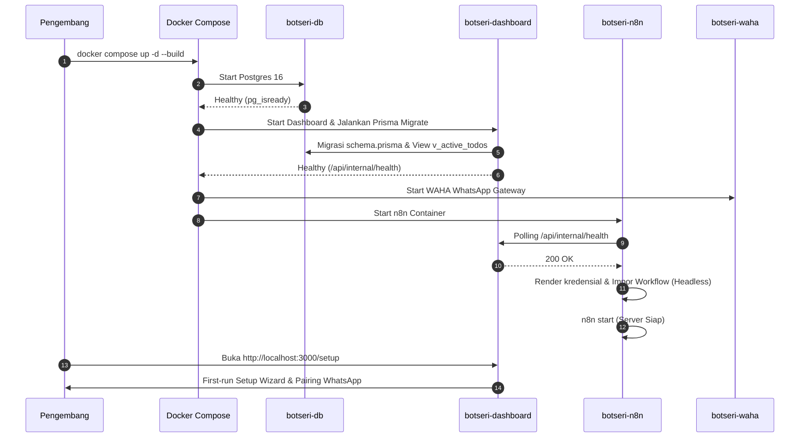

# IMPLEMENTATION_PLAN.md — Rencana Implementasi Teknis & Panduan Kode MVP

> **Status:** Ringkasan. **Rencana eksekusi kanonik ada di [`docs/steps/00-MASTER-ROADMAP.md`](steps/00-MASTER-ROADMAP.md).** Dokumen ini mempertahankan ringkasan milestone dan contoh komponen; jika bertentangan, step-by-step dan `ARCHITECTURE.md` yang menang.
> **Arsitektur Rujukan:** `ARCHITECTURE.md` §22 · **Target MVP:** Milestone M0 & M1
> **Pendekatan Rekayasa:** *Lazy Senior Dev Mode* — Solusi tuntas dengan baris kode seminimal mungkin, tanpa abstraksi berlebih.

---

## 1. Roadmap Milestone Keseluruhan (M0 – M6)

| Milestone | Target Fungsional | Kriteria Selesai (Definition of Done) |
|---|---|---|
| **M0 (Fondasi)** | Docker Compose (4 container), DB schema, Prisma migration, n8n auto-provisioning, dashboard healthcheck | Seluruh container sehat pada `docker compose up -d` |
| **M1 (Core Config)** | Setup Wizard first-run, Admin Auth (Argon2id), Priority Stack, Prompt Compiler (`lib/prompt`), `lib/crypto`, `lib/time` | UAT-12 lolos, unit test lib inti hijau |
| **M2 (Inbound Agent)** | LLM Gateway, integrasi WAHA, pairing nomor, workflow inbound agent n8n, 4 tools internal (tanpa Google) | UAT-01 s/d UAT-03 lolos di WhatsApp lokal |
| **M3 (Google Sync)** | Google OAuth2 flow, modul `lib/google/sync.ts`, sinkronisasi to-do ke Tasks/Calendar, retry sync | UAT-01, UAT-03, UAT-13 terverifikasi penuh |
| **M4 (Scheduler)** | Penjadwal `tick`, claim atomik, job Morning Brief, Work Hours Reminder, fallback text | UAT-04 s/d UAT-06 lolos |
| **M5 (Evaluasi)** | Job `END_OF_DAY_EVAL`, perhitungan snapshot `daily_stats`, kalkulasi tier, rollover otomatis, analitik | UAT-07 s/d UAT-11 lolos |
| **M6 (Hardening)** | Cloudflare Tunnel ingress, backup/restore script, monitoring page, security audit | Smoke test produksi berhasil |

---

## 2. Panduan Eksekusi Tahap Pertama: MVP (M0 & M1)



---

### Langkah 1: Inisialisasi Repositori & Docker Compose (M0)

1. Buat file `.env` dari `.env.example`.
2. Generate token rahasia:
   ```bash
   # Generate ENCRYPTION_KEY (32-byte base64)
   openssl rand -base64 32
   # Generate INTERNAL_API_TOKEN, SESSION_SECRET, N8N_ENCRYPTION_KEY
   openssl rand -hex 24
   ```
3. Pastikan `docker-compose.yml` mengisolasi port mikroservis:
   - `botseri-db:5432` (internal only)
   - `botseri-waha:3000` (internal only)
   - `botseri-n8n:5678` (internal only)
   - `botseri-dashboard:3000` (dipetakan ke `127.0.0.1:3000:3000`)

---

### Langkah 2: Setup Database & Migrasi Prisma (M0)

1. Konfigurasi `dashboard/prisma/schema.prisma` sesuai dengan `docs/DATABASE.md`.
2. Generate migrasi awal:
   ```bash
   cd dashboard
   npx prisma migrate dev --name init_botseri_core
   ```
3. Tambahkan skrip SQL untuk view kanonik `v_active_todos` ke dalam file migrasi yang dihasilkan:
   ```sql
   CREATE OR REPLACE VIEW v_active_todos AS
   SELECT 
       t.id, t.title, t.description, t.category, t.status,
       t.priority_level_id, p.rank AS priority_rank, p.label AS priority_label, p.color AS priority_color,
       t.due_at, t.has_specific_time, t.planned_date, t.order_id, t.rollover_count,
       t.created_via, t.google_sync_status, t.created_at, t.updated_at
   FROM todos t
   LEFT JOIN priority_levels p ON t.priority_level_id = p.id
   WHERE t.status IN ('PENDING', 'IN_PROGRESS')
   ORDER BY p.rank ASC, t.due_at ASC NULLS LAST, t.created_at ASC;
   ```
4. Tambahkan seed awal florist di `dashboard/prisma/seed.cjs` (Rank 1: Kritis, Rank 2: Bahan Baku/PO H-1, Rank 3: Pelunasan/Follow Up, Rank 4: Rutinitas).

---

### Langkah 3: Dashboard Healthcheck & Dockerfile (M0)

1. Buat endpoint `dashboard/src/app/api/internal/health/route.ts`:
   ```typescript
   import { NextResponse } from 'next/server';
   import { prisma } from '@/lib/db';

   export async function GET() {
     try {
       await prisma.$queryRaw`SELECT 1`;
       return NextResponse.json({ status: 'ok', db: true });
     } catch (err) {
       return NextResponse.json({ status: 'error', db: false }, { status: 503 });
     }
   }
   ```
2. Buat `dashboard/Dockerfile` multi-stage:
   - Build TypeScript & Next.js.
   - Entrypoint menjalankan `npx prisma migrate deploy` sebelum menjalankan `node server.js`.

---

### Langkah 4: Otomasi Headless n8n Engine (M0)

1. Buat `n8n-engine/Dockerfile`, `n8n-engine/credentials.template.json`, dan `n8n-engine/entrypoint.sh` persis sesuai spesifikasi teknis.
2. Buat dua workflow awal:
   - `n8n-engine/workflows/botseri-inbound-agent.json`
   - `n8n-engine/workflows/botseri-scheduler.json`
3. Jalankan container:
   ```bash
   docker compose up -d --build
   ```
4. Verifikasi status dengan `docker compose ps` dan pastikan tidak ada kontainer yang keluar (*exit*).

---

### Langkah 5: Modul Fondasi Domain (`dashboard/src/lib/`) (M1)

1. **`lib/crypto/`**: Enkripsi AES-256-GCM simetris dengan format tersimpan:
   `v1:<kid>:<iv-base64>:<ciphertext-base64>:<tag-base64>`. AAD berupa `<tabel>.<kolom>`.
2. **`lib/time/`**:
   - `toLocal(utcDate, tz)`
   - `isWorkingDay(date, workingDays, holidays)`
   - `nextWorkingDay(date, workingDays, holidays)`
   - `inWindow(currentTime, targetTime, windowMinutes)`
3. **`lib/prompt/`**:
   - Simpan template `dashboard/src/lib/prompt/templates/base.id.md`.
   - Implementasikan fungsi `compileSystemPrompt(settings, priorityLevels)` untuk menghasilkan `compiled_prompt`.
   - Implementasikan `renderPrompt(triggerType, runtimeContext)` untuk memilih blok `<!-- TRIGGER:... -->` yang relevan.

---

### Langkah 6: First-Run Wizard & Auth Admin (M1)

1. Buat alur autentikasi sesi berbasis cookie `HttpOnly` ditandatangani `SESSION_SECRET`.
2. Halaman `/setup`:
   - Validasi `SETUP_TOKEN` sebelum mengizinkan pembuatan akun admin pertama.
   - Form konfigurasi profil bisnis (`brand_name`, `business_type`, `owner_name`, `timezone`, jam kerja).
   - Form pengaturan Priority Stack (mengisi `priority_levels` dan mengompilasi prompt awal).
   - Menandai `bot_settings.setup_completed = true`.

---

## 3. Matriks Pengujian & Verifikasi MVP

| ID Tes | Lingkup yang Diuji | Cara Pengujian | Hasil yang Diharapkan |
|---|---|---|---|
| **SMK-01** | Orkestrasi Docker | `docker compose up -d` | 4 container status Healthy / Started |
| **SMK-02** | Zero-touch n8n | Periksa log `docker compose logs botseri-n8n` | Log menunjukkan "Dashboard sehat", kredensial terimpor, dan workflow aktif |
| **SMK-03** | Healthcheck DB | `curl -f http://127.0.0.1:3000/api/internal/health` | HTTP 200 `{ "status": "ok", "db": true }` |
| **SMK-04** | Keamanan Tunnel | Akses `curl -H "CF-Connecting-IP: 1.1.1.1" http://localhost:3000/api/internal/health` | HTTP 404 (ditolak oleh middleware) |
| **SMK-05** | Enkripsi Data | Unit test `lib/crypto` | Ciphertext terenkripsi benar, round-trip dekripsi menghasilkan string asli |
| **SMK-06** | Setup Wizard | Akses `http://localhost:3000/setup` di browser | Wizard selesai, data tersimpan di DB, prompt terkompilasi |
