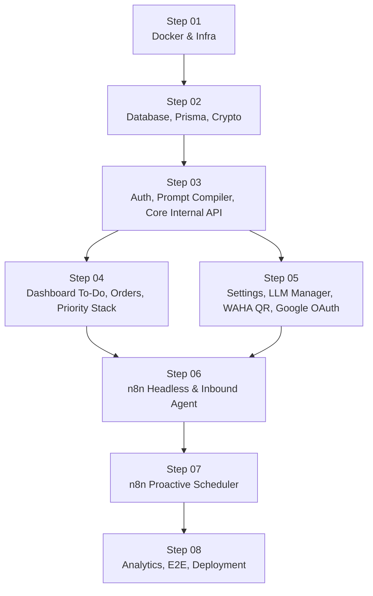

# 00 — MASTER ROADMAP: Botseri MVP → Production

> **Dokumen kanonik:** [`ARCHITECTURE.md`](../../ARCHITECTURE.md) v2.0 · [`DATABASE.md`](../DATABASE.md) · [`docs/WEBHOOK_AND_API.md`](../WEBHOOK_AND_API.md) · [`docs/AGENT_AND_PROMPT.md`](../AGENT_AND_PROMPT.md) · [`docs/VERSIONS.md`](../VERSIONS.md)
> **Sifat:** Wajib. Setiap step dieksekusi berurutan; step berikutnya tidak boleh dimulai sebelum Definition of Done step sebelumnya terpenuhi.

---

## 0.1 Prinsip yang Mengikat Seluruh Step

| Kode | Aturan | Konsekuensi Implementasi |
|---|---|---|
| INV-01 | PostgreSQL adalah SSOT; hanya `botseri-dashboard` yang terhubung ke database | **n8n, WAHA, dan tunnel tidak memiliki `DATABASE_URL`.** n8n mengambil konfigurasi dinamis lewat Internal API dashboard. |
| INV-02 | Rahasia tidak boleh ada di n8n, JSON workflow, atau log | API key LLM dan token Google hanya hidup terenkripsi di PostgreSQL; didekripsi oleh dashboard. |
| INV-03 | LLM tidak menghitung angka/statistik/urutan | Semua statistik, tier, dan urutan dihitung TypeScript; LLM menerima hasilnya sebagai data. |
| INV-04 | Job terjadwal idempoten lewat claim atomik | `INSERT ... ON CONFLICT ... WHERE status='FAILED' AND attempts<3` di `daily_execution_logs`. |
| INV-05 | Semua timestamp `timestamptz` (UTC); konversi lokal hanya lewat `lib/time` | Tidak ada `new Date()` liar di komponen; selalu `toLocal(now, timezone)`. |
| INV-06 | Workflow n8n tidak memuat aturan bisnis | Ambang evaluasi, slot reminder, dan urutan prioritas hanya di dashboard. |
| INV-07 | Pengirim tak terotorisasi tidak dibalas | `inbound/accept` mengembalikan `accept:false` tanpa `reply_text` (kecuali alur pairing). |
| INV-08 | `/api/internal/*` tidak dapat dijangkau dari internet | Middleware menolak header Cloudflare; aturan ingress tunnel menolak path tersebut. |
| INV-09 | Input LLM adalah input tak tepercaya | Setiap endpoint tool memvalidasi body dengan zod dan idempoten. |
| INV-10 | Pesan proaktif selalu lahir dari `daily_execution_logs` | `tick` membangun job; n8n hanya mengirim. |
| INV-12 | Perubahan skema hanya lewat migrasi Prisma maju | Tidak ada DDL manual di production; `init.sql` hanya untuk extension non-skema. |
| INV-13 | WAHA Anti-Ban Guard & Zero Direct Outbound | n8n dilarang menembak WAHA langsung. Semua outbound wajib via `POST /api/internal/waha/send` dengan antrean serial, jeda manusia, rate-limiter, dan circuit breaker. |

### Koreksi terhadap brief awal (dokumen menang)

1. **Brief menyebut n8n "membaca config dinamis dari Postgres".** Dokumen melarangnya (INV-01, ADR-002). Implementasi yang dipakai: n8n memanggil `GET /api/internal/context/chat` dan `POST /api/internal/llm/v1/chat/completions`; dashboard membaca PostgreSQL. Konfigurasi tetap dinamis, tetapi tanpa koneksi DB dari n8n.
2. **Brief menyebut tabel `priority_stacks`.** Nama kanonik adalah `priority_levels` (§5.2).
3. **Brief menyebut `seed.sql`.** Seed dijalankan oleh `dashboard/prisma/seed.cjs` (§19) agar satu sumber dengan tipe Prisma; tidak ada `seed.sql`.

---

## 0.2 Urutan Dependensi



Step 04 dan Step 05 sama-sama bergantung pada Step 03 dan dapat dikerjakan paralel oleh dua kontributor setelah Step 03 selesai. Step 06 membutuhkan keduanya karena tool memicu `syncTodo()` dan prompt membutuhkan data pengaturan.

---

## 0.3 Daftar Step & Status

| Step | File | Cakupan | Milestone ARCHITECTURE §22.1 | Status |
|---|---|---|---|---|
| 01 | [`step-01-docker-and-infra.md`](step-01-docker-and-infra.md) | Monorepo, `docker-compose.yml`, `botseri-net`, volume, `.env`, entrypoint n8n | M0 | `[x]` |
| 02 | [`step-02-database-and-orm.md`](step-02-database-and-orm.md) | Prisma schema, migrasi `v_active_todos`, seed, AES-256-GCM | M0, M1 | `[x]` |
| 03 | [`step-03-prompt-compiler-and-core-api.md`](step-03-prompt-compiler-and-core-api.md) | Session auth, setup token, `lib/time`, Prompt Compiler, Internal API auth, inbound/context/outbound, LLM Gateway | M1, M2 | `[x]` |
| 04 | [`step-04-dashboard-ui-todo-and-priority-stack.md`](step-04-dashboard-ui-todo-and-priority-stack.md) | Live board to-do & orders, drag-and-drop `priority_levels`, prompt editor/preview | M1 | `[x]` |
| 05 | [`step-05-dashboard-integrations-and-settings.md`](step-05-dashboard-integrations-and-settings.md) | Settings, LLM manager, WAHA QR/status, Google OAuth2 + `syncTodo` | M1, M3 | `[x]` |
| 06 | [`step-06-n8n-headless-engine-and-inbound-agent.md`](step-06-n8n-headless-engine-and-inbound-agent.md) | Workflow inbound, STT, AI Agent, 4 tool endpoint, usage logging | M2, M3 | `[x]` |
| 07 | [`step-07-n8n-proactive-scheduler.md`](step-07-n8n-proactive-scheduler.md) | `tick`, claim, brief/reminder/EOD, rollover, workflow scheduler | M4, M5 | `[ ]` |
| 08 | [`step-08-usage-analytics-and-e2e-testing.md`](step-08-usage-analytics-and-e2e-testing.md) | Analitik biaya/token, E2E, WSL2 + Cloudflare Tunnel, backup/restore | M6 | `[ ]` |

---

## 0.4 Milestone Acceptance (dari ARCHITECTURE §22.1)

| Milestone | Selesai Jika | Step Penutup |
|---|---|---|
| **M0** | `docker compose up` sehat: 4 container inti berjalan, migrasi awal diterapkan, `/api/internal/health` 200 | 02 |
| **M1** | Setup wizard selesai, admin login, Priority Stack dapat diubah, prompt terkompilasi, unit test `lib/crypto` dan `lib/time` hijau | 04/05 |
| **M2** | Pesan WhatsApp owner dibalas; to-do tersimpan; 4 tool berfungsi; LLM Gateway mencatat usage | 06 |
| **M3** | OAuth Google tersambung; to-do tersinkron ke Calendar/Tasks; retry berjalan; UAT-13 lolos | 05 + 06 |
| **M4** | Morning Brief dan Work Hours Reminder terkirim sesuai jadwal; fallback bekerja | 07 |
| **M5** | EOD Eval menghitung tier, menyimpan `daily_stats`, dan rollover berjalan sekali per hari | 07 |
| **M6** | Tunnel menolak `/api/internal`, backup/restore dilatih, smoke test produksi lolos | 08 |

**Status milestone:** M0 `[x]` (Step 02), M1 `[x]` (Step 04/05), M2 `[x]` (Step 06). M3–M6 `[ ]`.

---

## 0.5 Konvensi Kode Lintas Step

| Hal | Keputusan |
|---|---|
| Runtime | Node.js 20 LTS, TypeScript `strict: true` |
| Framework | Next.js 14 App Router (`dashboard/`), server components untuk baca, route handler untuk mutasi |
| ORM | Prisma 5.x; field Prisma memakai `snake_case` agar identik dengan kolom SQL (tanpa `@map` per kolom) |
| Validasi | zod di setiap batas kepercayaan: body Internal API, form admin, env |
| Auth admin | `argon2` (argon2id) + cookie JWT HS256 `HttpOnly; Secure; SameSite=Lax` via `jose` |
| Auth internal | `Authorization: Bearer ${INTERNAL_API_TOKEN}` dibandingkan `crypto.timingSafeEqual` |
| Waktu | `Intl.DateTimeFormat` + `date-fns`/`date-fns-tz`; UTC di DB, lokal hanya saat render |
| Google | `googleapis` resmi |
| UI | Tailwind CSS + komponen shadcn/ui; drag-and-drop `@dnd-kit/core` + `@dnd-kit/sortable` |
| Pengujian | `vitest` untuk unit; `docker compose` + `curl` untuk integrasi; tidak ada mock DB pada tes integrasi |
| Logging | JSON ke stdout; tidak pernah menulis body pesan atau rahasia |

### Perintah global (dijalankan di root repo)

```bash
cp .env.example .env          # isi manual atau jalankan scripts/gen-secrets.sh
docker compose config        # validasi sintaks compose
docker compose build         # build dashboard + n8n
docker compose up -d         # jalankan seluruh stack inti
docker compose ps            # semua service harus running/healthy
docker compose logs -f botseri-dashboard
```

### Definition of Done universal (setiap step)

1. Semua file pada daftar "File yang Dibuat/Dimodifikasi" ada dan tidak memuat placeholder.
2. Perintah verifikasi pada step dijalankan dan hasilnya sesuai.
3. Tidak ada rahasia baru di luar `.env.example`.
4. Tidak ada aturan bisnis baru di workflow n8n.
5. Item `[VERIFY]` yang disentuh dicatat di [`docs/VERSIONS.md`](../VERSIONS.md).

---

## 0.6 Checklist Progres

- [x] Step 01 — Docker & Infra
- [x] Step 02 — Database & ORM
- [x] Step 03 — Prompt Compiler & Core API
- [x] Step 04 — Dashboard To-Do & Priority Stack
- [x] Step 05 — Integrations & Settings
- [x] Step 06 — n8n Headless & Inbound Agent
- [ ] Step 07 — n8n Proactive Scheduler
- [ ] Step 08 — Analytics, E2E, Deployment
